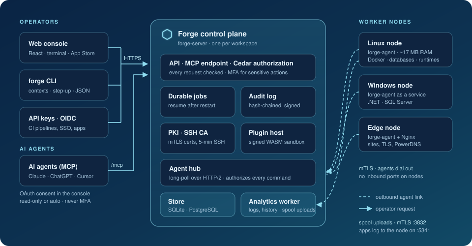

<div align="center">


# Orbyn Forge

**One secure control center for your Windows and Linux machines.**

[](https://github.com/mr-aybee/forge/actions/workflows/ci.yml)

[](LICENSE)


[Website](https://forge.orbyntech.com) · [Download](https://forge.orbyntech.com/download/) · [Quick start](#-quick-start) · [Features](#-what-you-get) · [How it works](#-how-it-works) · [Docs](https://forge.orbyntech.com/docs/) · [Security](docs/src/content/docs/security/index.md) · [Roadmap](docs/src/content/docs/roadmap.md)

</div>

---

Orbyn Forge is a lightweight, self-hosted, open-source platform written in Rust. Install one
control plane, add your servers to it as **nodes** grouped into **clusters**,
and manage everything from one web console: who can do what, what is running
where, and a tamper-evident record of every change.

> [!NOTE]
> Forge is an **orchestration layer**. It drives proven tools (Docker, Nginx,
> Caddy, PowerDNS, database servers) instead of re-implementing them.

<table>
<tr>
<td width="33%" valign="top">

### 🔐 Secure by construction
Cedar policy at every layer, MFA for sensitive actions, short-lived SSH
certificates, and a hash-chained, signed audit log.
See [Security](docs/src/content/docs/security/index.md).

</td>
<td width="33%" valign="top">

### 🪶 Lightweight
An idle agent uses about **17 MB** of RAM. One control plane runs
**1,000 agents** in about **87 MB**. See [BENCHMARKS.md](BENCHMARKS.md).

</td>
<td width="33%" valign="top">

### 🔁 Durable
Every operation is a job that survives restarts and resumes where it
stopped. Agents dial out over mutual TLS, so nodes need no inbound ports.

</td>
</tr>
</table>

## ✨ What you get

| | Area | What it does |
| :-: | --- | --- |
| 🗂️ | **Clusters, projects & environments** | One deployment is one workspace. Group machines into clusters. Model each product as a *project* with its *environments* (test, UAT, staging, production), each running in a cluster, and its *services* (API, UI, databases, containers) inside them. The Forge host is the *control node*; every other machine is a *worker node* running a small agent. |
| 🚀 | **Easy onboarding** | Give Forge a VM's SSH login (a sudo user, no root) and it installs the agent itself, or run a one-line installer. Credentials are encrypted, used once and deleted. |
| 💻 | **Browser terminal** | A full SSH terminal (tabs, split view, search, themes) using 5-minute certificates from Forge's SSH CA. No stored passwords or keys. |
| 🧩 | **App Store** | Install PHP, Python, Node.js, Java, .NET, Go, Nginx, PostgreSQL, MariaDB, Redis, MongoDB, SQL Server, RustFS, Docker, PowerDNS, Certbot and Keepalived on one or many nodes. Generated passwords stay on the node. |
| 🐳 | **Containers** | Manage Docker containers and images on any node with Docker. Deploy Docker Compose stacks across nodes from a visual preview, or create a single container from a form; host-access settings need an administrator with MFA, ports stay internal unless marked public, and services can be exposed through Nginx. |
| 📂 | **File explorer** | Browse, edit, upload, search and restore files on Linux and Windows nodes and in containers, with a code editor, conflict-safe saves, trash and revisions. Hand out expiring SFTP access for FileZilla or WinSCP without node accounts. Operators get only approved directories, links are never followed, Forge keys stay protected and every access is audited. |
| 🪣 | **Object storage** | Install RustFS on a node as a managed S3 store, or connect AWS S3, R2, Wasabi, B2 or MinIO, and browse buckets and objects from the console. Issue apps keys limited to one bucket. Grant one person access to one bucket, read-only or read-write, without a role or an S3 key. Keys stay in the vault. |
| 🛰️ | **Port tunnels** | Reach a service's port from your laptop through the API port alone: `forge tunnel open --app site`, `--stack seq-b --service seq`, `--db orders-pg` or `--ssh`. Targets come from what actually listens, access from a role on the service's namespace or an explicit, expiring grant; every tunnel is audited, listed and revocable. |
| 📦 | **Services** | Run systemd services and containers with first-class environment variables (env file, `.env`, sealed secrets, package variables) and active/standby placement. |
| 🚢 | **Releases & rollouts** | Describe a release in a `forge.deploy.yaml` and roll it out with `forge deploy apply --wait` from a terminal or CI: rolling, blue-green, canary (with error-rate and latency gates), recreate or manual strategies, side-by-side slots with traffic shifted through the edges, health gates, four-eyes approvals, crash-safe resume and automatic rollback. |
| 🌐 | **Sites & DNS** | Route domains through Nginx edge nodes (TLS, standby upstreams, rate limits, custom blocks with automatic rollback) and publish records on PowerDNS. |
| 🛡️ | **Access control** | Roles on everything or per cluster, project, environment or service, enforced by [Cedar](https://www.cedarpolicy.com) at every layer. Sensitive actions require MFA, which is on by default and is each server's operator's choice. API keys for scripts and CI. |
| 🔑 | **Sign-in** | Local accounts with TOTP or passkeys, single sign-on (OIDC), and OAuth + PKCE for desktop and mobile apps. A self-hosted proof-of-work login challenge and per-account and per-address limits slow password guessing, codes work once, and refresh tokens expire. See [Security](docs/src/content/docs/security/index.md). |
| ⌨️ | **`forge` CLI** | Manage nodes, agents, jobs, projects, services, stacks, files and the audit log from a terminal or a pipeline, or call any API route with `forge api`. Named contexts, browser or device-code sign-in for SSH sessions, MFA step-up when an action needs it, JSON output and stable exit codes. Ships with every release for Linux and Windows. |
| 🤖 | **AI agents (MCP)** | Connect Claude, ChatGPT, Gemini CLI, Codex and Cursor to Forge's built-in MCP endpoint. Approve each agent in the console as read-only or auto; it acts with your permissions, destructive and MFA-protected actions stay with a person, and every change is audited with the agent's name. Off by default. |
| 📜 | **Durable jobs & audit** | Every operation is a job that survives restarts; every action lands in a hash-chained, signed audit log. |
| 🚨 | **Alerts & notifications** | Rules open an alarm when a node goes offline, when CPU, memory or disk stay high, or when a health check fails. Missing data never counts as recovery. Acknowledge alarms, and send them to a signed webhook, a Slack-compatible chat or email over SMTP with retries, reminders and a delivery history. Silence alarms or schedule maintenance windows without losing alarm history. |
| 🔎 | **Service logs** | Services send structured logs with any Seq client (Serilog, Python, Node.js or plain CLEF over HTTP) using a per-service ingest key. Search by text or property, filter by level, follow a live tail and see counts per level over time. Stored in the analytics database (DuckDB inside Forge by default; embedded ClickHouse or a ClickHouse server for heavy load) with its own retention; who reads which service's logs is a Cedar permission. |
| 🔄 | **Agent updates** | Bring the agents on Linux nodes up to the control plane's version from the console or the CLI. Each update is verified, and a node rolls back on its own if the new agent does not come back. |
| 🔌 | **Plugins** | Signed WebAssembly extensions in a strict sandbox. |

**Coming next:** GitHub deployments, backups, alert
escalation, database management, scheduled automation, Traefik/YARP. See the
[roadmap](docs/src/content/docs/roadmap.md).

## 🧭 How it works

<p align="center">
  
</p>

Every request is authorized where it takes effect (API, MCP endpoint, job
runner, agent hub, agent and plugin host) and every change is audited,
including denials. Read [ARCHITECTURE.md](ARCHITECTURE.md) for components,
trust boundaries and the data model.

## 🚀 Quick start

<details open>
<summary><b>Install on Linux</b></summary>

On a Linux server with systemd (x86_64 or arm64):

```sh
curl -fsSLO https://github.com/mr-aybee/forge/releases/latest/download/get-forge.sh
sudo sh get-forge.sh
```

`get-forge.sh` downloads the package for this machine, checks its signature
and checksum, and runs the installer. The installer asks a few questions
(press **Enter** for the defaults), then
prints the console address and the administrator password. Full walkthrough:
[Quickstart](https://forge.orbyntech.com/docs/getting-started/quickstart/).

</details>

<details>
<summary><b>Install on Windows</b></summary>

Releases do not include the Windows control plane or the Windows agent yet.
The Windows code is in the source, so you can build them yourself, but those
builds are not verified. On Windows, releases publish only the `forge` CLI
(`forge-cli-x86_64-pc-windows-msvc.exe`); see
[Install on Windows](https://forge.orbyntech.com/docs/reference/cli/#install-on-windows).

</details>

<details>
<summary><b>Build from source (contributors)</b></summary>

**Prerequisites:** [Rust](https://rustup.rs) (stable) and [Node.js](https://nodejs.org) 20+.

```powershell
# 1. Build the control plane, agent and plugin runner
cargo build --release -p forge-server -p forge-agent -p forge-plugin-runner -p forge-analytics-worker

# 2. Build the web console
cd src/ui; npm ci; npm run build; cd ../..

# 3. Create the first administrator (password is read from the environment)
$env:FORGE_ADMIN_PASSWORD = "choose-a-long-passphrase"
target\release\forge-server.exe --config scripts/dev/forge.dev.toml init --username admin
Remove-Item Env:FORGE_ADMIN_PASSWORD

# 4. Start it
target\release\forge-server.exe --config scripts/dev/forge.dev.toml serve
```

Open **http://localhost:8090** and sign in. The dev config uses port 8090;
change `api_listen` and `public_url` in `scripts/dev/forge.dev.toml` if needed.
See [Run from source](docs/src/content/docs/development/run-from-source.md).

</details>

<details>
<summary><b>Linux test lab in WSL (contributors)</b></summary>

A ready-made lab: the control plane plus three small Linux "VMs"
(1 CPU / 1 GB each) in Docker inside WSL.

```powershell
# one-time setup (installs Docker Engine and Rust inside Ubuntu)
wsl -d Ubuntu-24.04 -u root -- bash scripts/lab/setup-wsl.sh <your-wsl-user>

# build, then start
wsl -d Ubuntu-24.04 -- bash scripts/lab/build.sh
cd src/ui; npm run build; cd ../..
wsl -d Ubuntu-24.04 -- bash scripts/lab/up.sh
```

`up.sh` prints the console URL (http://localhost:8090), the admin login and the
login for the test nodes `node-1`, `node-2` and `node-3`. Stop with
`scripts/lab/down.sh` (add `--reset` to wipe it). Details:
[Linux test lab](docs/src/content/docs/development/linux-lab.md).

</details>

### First steps in the console

1. **Settings → Password & security → Multi-factor authentication.** Enable it, then sign out and in
   again with a code. You need it to onboard nodes with credentials.
2. **Clusters → New cluster**, for example `production`.
3. **Nodes → Add node.** *Assisted*: enter the machine's address and an SSH
   login. *Manual*: copy the one-line installer to the machine.
4. Open the node and press **Ping** or **Collect facts**.

## 📁 Project layout

| Path | What's there |
| --- | --- |
| `src/domain` | Core types and interfaces |
| `src/services` | Authorization, audit, identity, jobs, PKI, secrets, plugin host |
| `src/adapters` | Database (SQLite/PostgreSQL), analytics (ClickHouse, DuckDB) and SSH |
| `src/protocol` | Agent protocol and plugin SDK |
| `src/apps` | `forge-server`, `forge-analytics-worker`, `forge-agent`, `forge-plugin-runner`, `forge` CLI |
| `src/ui` | Web console (React + TypeScript) |
| `src/tools`, `src/plugins` | Fleet benchmark, sample plugin |
| `website/` | forge.orbyntech.com (React + TypeScript) and its container image |
| `docs/` | Documentation site, served at `/docs/`: `cd docs; npm ci; npm run dev` |
| `scripts/` | Dev config, the WSL lab, release packaging and the license |
| `branding/` | Logo files |

## 📚 Learn more

| Read | For |
| --- | --- |
| [Website](https://forge.orbyntech.com) | Features, use cases and downloads |
| [Documentation](https://forge.orbyntech.com/docs/) | Guides, concepts and API reference (source in [docs/](docs/)) |
| [Security](docs/src/content/docs/security/index.md) | How Forge protects a fleet, what it enforces and open security work |
| [ARCHITECTURE.md](ARCHITECTURE.md) | Components, trust boundaries, data model |
| [DECISIONS.md](DECISIONS.md) | Why things are the way they are |
| [BENCHMARKS.md](BENCHMARKS.md) | Measured memory and CPU use |
| [CONTRIBUTING.md](CONTRIBUTING.md) | Fork, branch, test and open a pull request |
| [CLAUDE.md](CLAUDE.md) | Code, security and docs conventions |
| [SECURITY.md](SECURITY.md) | Reporting vulnerabilities privately |

## 🛠️ Development

Contributions arrive as pull requests from forks:

```sh
git clone https://github.com/<your-user>/forge.git   # your fork of mr-aybee/forge
cd forge
git remote add upstream https://github.com/mr-aybee/forge.git
git switch -c <topic> upstream/develop
```

Before you open a PR into `develop`, run:

```sh
cargo fmt --all && cargo clippy --workspace --all-targets -- -D warnings
cargo test --workspace
cargo deny check && cargo audit
```

See [CONTRIBUTING.md](CONTRIBUTING.md) and
[Testing](docs/src/content/docs/development/testing.md).

---

<div align="center">
<sub>Orbyn Forge · Open source under the <a href="LICENSE">Apache License 2.0</a> · Built by <a href="https://github.com/orbyntech">Orbyn Technologies</a></sub>
</div>
